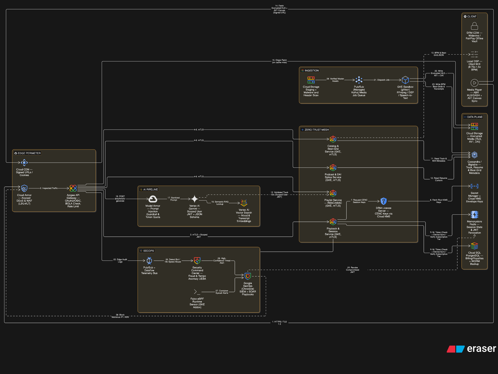
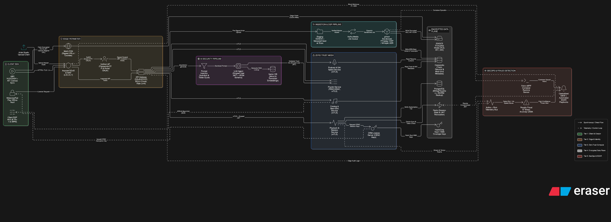

# Spotify Zero-Trust Security & Multi-Modal Streaming Architecture — GCP
## Step-by-Step Explanation (Steps 1 to 30)

**Diagram source:** `GCP.png` 
**Layout:** `direction right` — Layers 1 to 7 are columns left to right. All 30 connections are listed below the columns in execution order.  
**Arrows:** `>` = main forward flow (solid). `-->` = return / cross-layer flow (dashed). Comma fan-out (e.g. `A > B, C`) means one source with the same label to multiple destinations.

---

---

This document explains every step in order and expands every acronym to its full form on first use.
---

---

## 1. Acronym Glossary (Full Forms)

| Acronym | Full Form |
|---|---|
| ABR | Adaptive Bitrate Streaming |
| AI | Artificial Intelligence |
| API | Application Programming Interface |
| ASR | Automatic Speech Recognition |
| AV1 | AOMedia Video 1 (open video codec) |
| BOLA | Broken Object Level Authorization |
| BPM | Beats Per Minute |
| CENC | Common Encryption (Common ENCryption scheme for DRM) |
| CDM | Content Decryption Module |
| CDN | Content Delivery Network |
| DAI | Dynamic Ad Insertion |
| DASH | Dynamic Adaptive Streaming over HTTP |
| DDoS | Distributed Denial of Service |
| DSP | Digital Signal Processing |
| DRM | Digital Rights Management |
| FFmpeg | Fast Forward Moving Picture Experts Group (multimedia transcoding tool) |
| GKE | Google Kubernetes Engine |
| HLS | HTTP Live Streaming |
| HTTPS | Hypertext Transfer Protocol Secure |
| JWT | JSON Web Token (RFC 7519, scoped, short-lived identity token) |
| KMS | Key Management Service (Google Cloud KMS) |
| L3 / L4 / L7 | Layer 3 Network / Layer 4 Transport / Layer 7 Application (OSI model layers) |
| LLM | Large Language Model |
| MIX | Client-side tempo/pitch mix mode (0.75x–1.5x playback speed range in this design) |
| mTLS | Mutual Transport Layer Security (both client and server present certificates) |
| OAuth2 | Open Authorization version 2.0 |
| OIDC | OpenID Connect |
| Pub/Sub | Publish / Subscribe messaging (Google Cloud Pub/Sub, used here as managed Apache Kafka equivalent) |
| RAG | Retrieval-Augmented Generation |
| RBAC / ABAC | Role-Based Access Control / Attribute-Based Access Control |
| Redis | Remote Dictionary Server (in-memory store, here via Memorystore for Redis) |
| SIEM | Security Information and Event Management (here Google SecOps, formerly Chronicle) |
| SOAR | Security Orchestration, Automation and Response |
| SQL | Structured Query Language (here Cloud SQL for PostgreSQL) |
| TLS | Transport Layer Security (version 1.3) |
| UEBA | User and Entity Behavior Analytics |
| eBPF | Extended Berkeley Packet Filter (kernel-level observability technology, used by Falco) |
| WAF | Web Application Firewall (here Google Cloud Armor) |
| WORM | Write Once Read Many (immutable backup for billing/royalty compliance) |
| JSON | JavaScript Object Notation (here JSON Schema for LLM output validation) |
| GCS | Google Cloud Storage (labeled as Cloud Storage in the diagram) |
| SCC | Security Command Center (Google Cloud's security and risk dashboard) |
| SecOps | Security Operations (Google Cloud's SecOps / Chronicle SIEM + SOAR) |

---

## 2. Layers 1 to 7 (Columns, Left to Right)

### Layer 1 — Client (`Client [icon: spotify]`)
User device. No color fill, Spotify icon on the group.
- **Media Player** — Adaptive Bitrate Streaming player for HTTP Live Streaming / Dynamic Adaptive Streaming over HTTP, plus AOMedia Video 1 Canvas visuals sync.
- **Local DSP (Digital Signal Processing)** — Client-side tempo MIX engine, 0.75x–1.5x Beats Per Minute-aware time-stretch.
- **CDM Vault (Content Decryption Module Vault)** — Widevine / FairPlay offline license vault. Decrypts only; keys never leave the Content Decryption Module sandbox.

### Layer 2 — Edge Perimeter (`Edge Perimeter [icon: google-cloud]`)
Google Cloud edge. Entry point for all internet traffic.
- **WAF (Web Application Firewall)** — Google Cloud Armor. Anycast Distributed Denial of Service absorption plus Layer 3 / Layer 4 / Layer 7 Web Application Firewall rules.
- **API Gateway** — Apigee API Gateway. Enforces Open Authorization 2.0 / OpenID Connect login, Broken Object Level Authorization check (user can only access their own objects), and rate limiting.
- **Cloud CDN (Content Delivery Network)** — Google Cloud Content Delivery Network. Serves encrypted segments via time-bound Signed URLs / Signed Cookies only.

### Layer 3 — Zero-Trust Mesh (`Zero-Trust Mesh [icon: gcp-anthos-service-mesh]`)
Anthos Service Mesh on Google Kubernetes Engine. Every service-to-service call requires Mutual Transport Layer Security. No implicit trust.
- **Playback** — Playback and session service. Owns play sessions and device sync.
- **Catalog** — Catalog and beat-grid service. Owns track metadata and Beats Per Minute grids.
- **Podcast** — Podcast and Dynamic Ad Insertion splice service. Owns resume cursors and ad stitching.
- **Playlist** — Playlist service with Role-Based and Attribute-Based Access Control.
- **DRM Server (Digital Rights Management Server)** — License server. Mints Common Encryption content keys via Cloud Key Management Service.

### Layer 4 — AI Pipeline (`AI Pipeline [icon: gcp-vertexai]`)
Vertex Artificial Intelligence playlist generation with guardrails.
- **Guardrail** — Google Model Armor. Prompt-injection filter plus token quota.
- **LLM (Large Language Model)** — Vertex Artificial Intelligence Gemini agent. Called only with a scoped JSON Web Token and must return JSON Schema-validated output.
- **Vector DB (Vector Database)** — Vertex Artificial Intelligence Vector Search. Mood and transcript embeddings for semantic lookup.

### Layer 5 — Ingestion (`Ingestion [icon: gcp-cloud-storage]`)
Upload-to-catalog pipeline. Untrusted input is quarantined here.
- **Staging Bucket** — Cloud Storage staging. Malware and header scan before anything else runs.
- **Job Queue** — Cloud Pub/Sub (managed Apache Kafka equivalent). Durable media job queue.
- **Sandbox Workers** — Google Kubernetes Engine Sandbox with gVisor isolation. Runs FFmpeg transcoding, Digital Signal Processing, and Speech-to-Text (Automatic Speech Recognition via Whisper-style model).

### Layer 6 — Data Plane (`Data Plane [icon: gcp-secret-manager]`)
Polyglot persistence and secrets. Only encrypted writers and scoped readers.
- **Secrets Vault** — Secret Manager plus Cloud Key Management Service envelope keys.
- **Redis (Remote Dictionary Server)** — Memorystore for Redis. Session state and JSON Web Token revocation list.
- **PostgreSQL** — Cloud Structured Query Language for PostgreSQL. Billing and royalties, plus Write Once Read Many immutable backup.
- **Cassandra** — Cassandra / Bigtable wide-column store. Track, resume-cursor, and beat-grid metadata.
- **Media Store** — Cloud Storage. Encrypted master media: HTTP Live Streaming segments, AOMedia Video 1 assets, Dynamic Ad Insertion creatives.

### Layer 7 — SecOps (`SecOps [icon: gcp-security-operations]`)
Security Operations telemetry and response.
- **Telemetry Bus** — Cloud Pub/Sub plus Dataflow streaming bus.
- **UEBA (User and Entity Behavior Analytics)** — Security Command Center anomaly engine for royalty fraud and tempo abuse.
- **Runtime Sensor** — Falco Extended Berkeley Packet Filter sensor (Google Kubernetes Engine add-on). Watches container syscalls.
- **SIEM SOAR (Security Information and Event Management + Security Orchestration, Automation and Response)** — Google Security Operations (Chronicle). Correlates alerts and runs automated playbooks.

---

## 3. Steps 1 to 30 — In Order

### Phase A — Client request enters Edge, fans out via API Gateway (Steps 1–6)

**Step 1. `Media Player > WAF: 1. HTTPS / TLS 1.3`**
Mobile/web player opens a Hypertext Transfer Protocol Secure session with Transport Layer Security 1.3 to the edge. Encrypts everything in transit and lets Cloud Armor see the true client IP for later blocking.

**Step 2. `WAF > API Gateway: 2. Inspected Traffic`**
Cloud Armor scrubs Distributed Denial of Service floods and Layer 7 attacks, then forwards only clean traffic to Apigee. Malicious requests die here and never reach microservices.

**Step 3. `API Gateway > Playback: 3. mTLS + Scoped JWT`**
Apigee validates the Open Authorization 2.0 / OpenID Connect JSON Web Token, checks Broken Object Level Authorization and rate limit, then calls Playback over Mutual Transport Layer Security with a short-lived scoped JSON Web Token. Proves who the user is and which device/session this is.

**Steps 4–6. `API Gateway > Catalog, Podcast, Playlist: 4-6. mTLS`**
Same Apigee checks, fanned out in one line to three services over Mutual Transport Layer Security:
- **4 → Catalog:** fetch track and beat-grid metadata.
- **5 → Podcast:** fetch episode and resume state.
- **6 → Playlist:** read/write user playlists under Role-Based / Attribute-Based Access Control.

### Phase B — Services fetch keys, sessions, and metadata (Steps 7–12)

**Step 7. `Playback > DRM Server: 7. Request CENC Session Keys`**
Playback asks the Digital Rights Management server for a per-session Common Encryption content key. No key = no decryption, even if the user already downloaded segments.

**Step 8. `DRM Server > Secrets Vault: 8. Fetch Root KMS Keys`**
The Digital Rights Management server unwraps the root key from Secret Manager / Cloud Key Management Service using envelope encryption. Root keys never sit in application config or containers.

**Steps 9–10. `Playback > Redis, PostgreSQL: 9-10. Token Check + Device Sync / Verify Subscription Tier`**
One fan-out, two checks in parallel:
- **9 → Memorystore for Redis (Remote Dictionary Server):** is this JSON Web Token revoked? Sync playback position across the user's devices.
- **10 → Cloud Structured Query Language for PostgreSQL:** what subscription tier? Free vs. premium gates audio quality and offline rights. Write Once Read Many backup preserves royalty evidence.

**Step 11. `Catalog > Cassandra: 11. Read Track & MIX Metadata`**
Catalog reads track rows plus client MIX tempo maps from Cassandra / Bigtable. Wide-column store is chosen because beat-grid reads are high-throughput key lookups.

**Step 12. `Podcast > Cassandra: 12. Read Resume Cursors`**
Podcast reads the listener's resume cursor (episode + position) so playback resumes exactly where it stopped.

### Phase C — Content delivered back to the client (Steps 13–15)

**Step 13. `Catalog --> Local DSP: 13. BPM & Beat-Grid JSON`**
Dashed return edge. Catalog sends Beats Per Minute and beat-grid JavaScript Object Notation to the on-device Digital Signal Processing engine so 0.75x–1.5x time-stretch stays on-beat without another server round-trip.

**Step 14. `Media Player > Cloud CDN: 14. Fetch Encrypted HLS + AV1 Canvas (Signed URL)`**
Player fetches still-encrypted HTTP Live Streaming segments and AOMedia Video 1 Canvas clips from Cloud Content Delivery Network. URLs are signed and expire in minutes, so sharing a link does not share content.

**Step 15. `Cloud CDN > Media Store: 15. Origin Fetch (on cache miss)`**
On cache miss only, Cloud Content Delivery Network pulls the encrypted object from Cloud Storage origin. Edge caches hot content; origin stays authoritative.

### Phase D — AI playlist generation pipeline (Steps 16–19)

**Step 16. `API Gateway > Guardrail: 16. POST /playlists/ai-generate`**
Apigee forwards the user's natural-language prompt to Model Armor. Raw prompts never touch the Large Language Model directly.

**Step 17. `Guardrail > LLM: 17. Sanitized Prompt`**
Model Armor strips prompt-injection, checks token quota, and forwards only the sanitized prompt to the Vertex Artificial Intelligence Gemini agent.

**Step 18. `LLM > Vector DB: 18. Semantic RAG Lookup`**
Gemini performs Retrieval-Augmented Generation against Vertex Artificial Intelligence Vector Search (mood + transcript embeddings) to ground suggestions in the real catalog instead of hallucinating tracks.

**Step 19. `LLM --> Playlist: 19. Validated Track IDs (Scoped User JWT)`**
Dashed edge. Gemini returns only JSON Schema-validated track IDs plus the user's scoped JSON Web Token. Playlist service re-checks Role-Based / Attribute-Based Access Control before writing, so the model cannot escalate privileges.

### Phase E — Media ingestion and sandboxed transcoding (Steps 20–23)

**Step 20. `Staging Bucket > Job Queue: 20. Verified Master Assets`**
Only masters that passed malware and header scan are published to Cloud Pub/Sub. Unverified uploads never get a job.

**Step 21. `Job Queue > Sandbox Workers: 21. Dispatch Job`**
Pub/Sub dispatches one transcode job per asset. Queue decouples upload spikes from worker capacity.

**Step 22. `Sandbox Workers > Media Store: 22. Write Encrypted HLS + AV1 + DAI`**
gVisor-isolated workers write encrypted HTTP Live Streaming renditions, AOMedia Video 1 assets, and Dynamic Ad Insertion segments to Cloud Storage. A compromised codec cannot escape the sandbox to reach customer data.

**Step 23. `Sandbox Workers > Cassandra: 23. Write BPM Beat-Grids & Transcripts`**
Same workers write derived metadata — Beats Per Minute beat-grids from Digital Signal Processing and transcripts from Automatic Speech Recognition — to Cassandra / Bigtable for Steps 11 and 18 to read later.

### Phase F — Telemetry and fraud detection (Steps 24–28)

**Step 24. `Playback > Telemetry Bus: 24. Stream & Tempo Events`**
Playback emits play, pause, seek, and tempo-change events to Pub/Sub + Dataflow. This is the raw signal for fraud detection.

**Step 25. `API Gateway > Telemetry Bus: 25. Edge Audit Logs`**
Apigee emits edge audit logs (who called what, from which IP / Autonomous System Number, with what token). Correlates client claims against server reality.

**Step 26. `Telemetry Bus > UEBA: 26. Detect Bot / 10x Speed Abuse`**
User and Entity Behavior Analytics job in Security Command Center flags bots and 10x-speed abuse (e.g. looping tracks at high speed to farm royalties).

**Step 27. `Runtime Sensor > SIEM SOAR: 27. Container Syscall Alerts`**
Falco Extended Berkeley Packet Filter sensor reports anomalous container syscalls (unexpected shell, key-file read) to Google Security Operations.

**Step 28. `UEBA > SIEM SOAR: 28. High-Confidence Threat Alert`**
Only high-confidence User and Entity Behavior Analytics findings are forwarded to Security Information and Event Management to avoid alert fatigue.

### Phase G — Automated response, closed loop (Steps 29–30, dashed)

**Step 29. `SIEM SOAR --> Redis: 29. Revoke Compromised JWT`**
Dashed return edge. Security Orchestration, Automation and Response playbook writes the stolen JSON Web Token's ID to the Memorystore for Redis revocation list. Step 9 then rejects it within milliseconds — session killed without code deploy.

**Step 30. `SIEM SOAR --> WAF: 30. Block Malicious IP / ASN`**
Dashed return edge. Playbook pushes the attacker IP / Autonomous System Number to Cloud Armor blocklist. Step 2 then drops that actor at the edge before any microservice or cost is incurred.

---

## 4. End-to-End Reading (One Sentence Per Phase)

1. **Request (1–6):** Client → Cloud Armor → Apigee → four mesh services, all over Transport Layer Security 1.3 then Mutual Transport Layer Security with scoped JSON Web Tokens.
2. **Authorize (7–12):** Playback mints Common Encryption keys via Cloud Key Management Service, checks revocation in Redis and tier in PostgreSQL; Catalog and Podcast hydrate from Cassandra / Bigtable.
3. **Deliver (13–15):** Beat-grids go to on-device Digital Signal Processing; encrypted media flows via signed Content Delivery Network URLs with Cloud Storage as origin.
4. **Generate (16–19):** Prompts pass Model Armor → Gemini → Vector Search → Playlist, with JSON Schema and Role-Based / Attribute-Based Access Control at both ends.
5. **Ingest (20–23):** Scanned masters queue in Pub/Sub, transcode in gVisor sandbox, land encrypted in Cloud Storage with metadata in Cassandra / Bigtable.
6. **Detect (24–28):** Playback and edge events stream through Dataflow into User and Entity Behavior Analytics and Falco, correlated in Google Security Operations.
7. **Respond (29–30):** Security Orchestration, Automation and Response revokes tokens in Redis and blocks IPs in Cloud Armor — the loop closes back to Steps 9 and 2.
